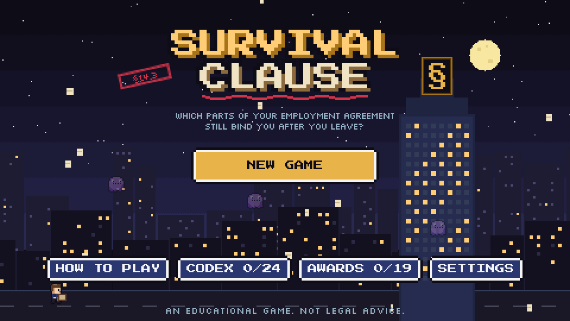
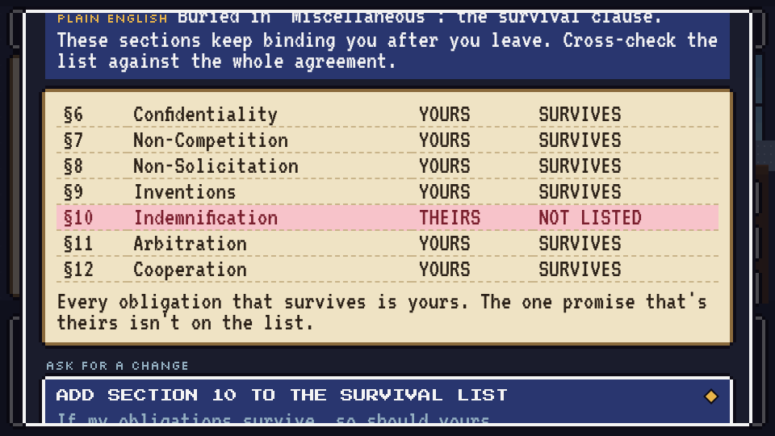
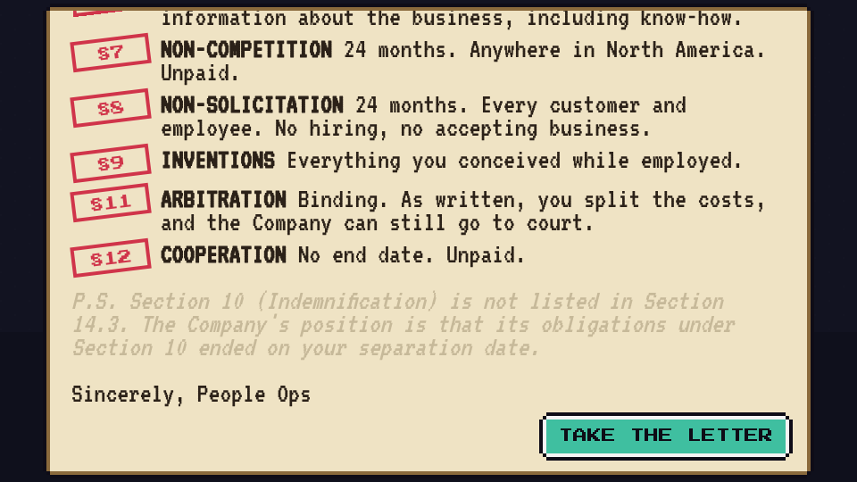
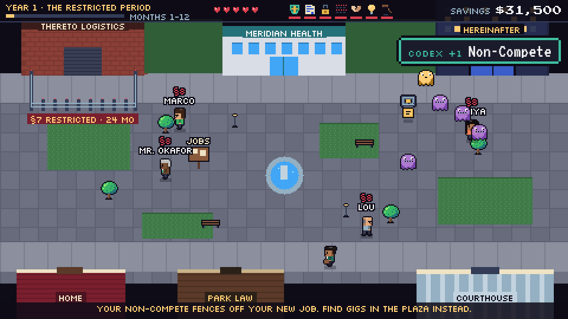
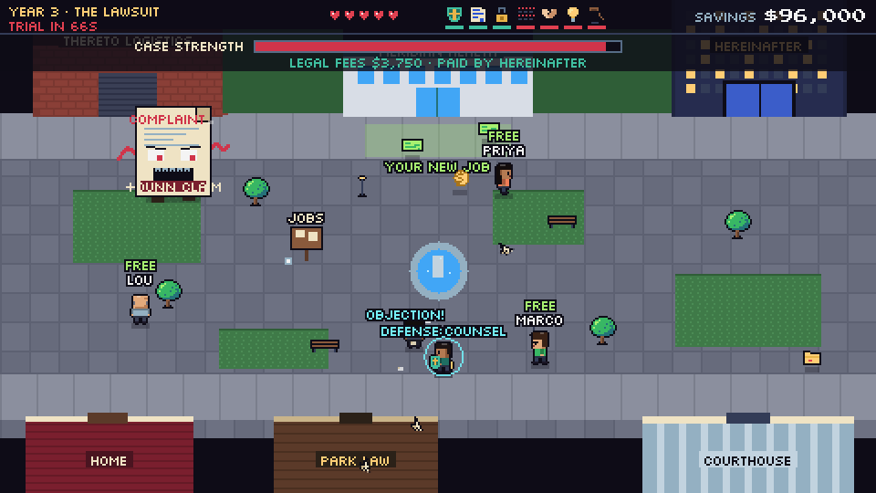
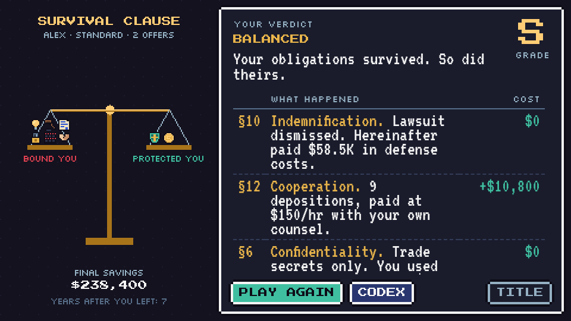

# Survival Clause

**Which parts of your employment agreement still bind you after you leave?**

Survival Clause is a free pixel-art game about the survival clause: the short list near the end of most employment agreements that decides which obligations outlive the job. Negotiate your offer, work four years, then survive the seven years after you quit, when the clauses that survived come after you.

**[Play it in your browser](https://jpcrook11.github.io/survival-clause/)** · about 15 minutes · keyboard, mouse, or touch



## How it plays

**1. The Offer.** Read a 14-section employment agreement. Spend limited leverage on redlines and keep an eye on goodwill: fair asks usually get a yes, but overreach and the offer is withdrawn. Somewhere in "Miscellaneous" is the survival clause. Check what's on the list, and what isn't.



**2. The Job.** Four years of decisions: a vendor letter you sign, a weekend side project, a trade secret you learn, a layoff you run. Some of them come back later.

**3. The Exit.** HR hands you a "reminder of continuing obligations." Notice what's missing.



**4. After You Leave.** Seven years in which every surviving clause becomes a threat: confidentiality phantoms that never expire, a non-compete fence around your new job, former coworkers you can't recruit, a subpoena storm, a claw that takes your side project, a lawsuit that names you personally, and an arbitration room. Whatever you negotiated fights back for you.




**The verdict** totals what each clause cost you and checks your agreement against a balanced survival clause:

- Indemnification that survives termination, including a duty to defend in third-party lawsuits
- Cooperation that compensates you for your time, including attorney fees if you need separate counsel
- Lifetime confidentiality limited to genuine trade secrets, not general business information

The best time to balance it is at the offer stage, long before you ever need it.



Also inside: a 24-entry clause glossary, 19 achievements, four endings, three difficulty levels, and an original chiptune soundtrack.

## Controls

| Action | Keyboard | Touch |
| --- | --- | --- |
| Move | WASD or arrow keys | Left stick |
| Dash | Space | DASH button |
| Menus | Arrow keys + Enter, or click | Tap |
| Pause | Esc | II button |
| Mute | M | Settings |

Progress saves automatically at each chapter, in the player's own browser. The game has no tracking, no cookies, and no outside requests.

## Hosting

The game is hosted free on GitHub Pages at https://jpcrook11.github.io/survival-clause/, built from the `main` branch, `/ (root)` folder. `index.html` has to sit at the top level of the repository, next to this README. GitHub doesn't unzip uploads, so upload the unzipped files, never the zip.

To publish a new version, upload the new `index.html` (**Add file → Upload files**) and commit. Pages redeploys in a minute or two.

For a repository preview image, upload `assets/social-preview-github.png` under **Settings → General → Social preview**.

To host your own copy, upload these files to a public repository, turn on Pages under **Settings → Pages**, and change `jpcrook11` to your username in `source/head.html`. Then rebuild with `python3 source/build.py`, so shared links show your preview image.

## Editing the game

`index.html` is the whole game in one file: code, art, fonts, and music. You never need to touch it directly. To change the game, edit the files in `source/` and rebuild:

```
python3 source/build.py
```

That writes a fresh `index.html`. It needs only Python 3.

| Where | What |
| --- | --- |
| `source/js/10_data.js` | All the writing: the agreement, negotiation options, career events, codex, achievements |
| `source/js/31_offer.js` | Chapter 1, the negotiation |
| `source/js/32_career.js` | Chapters 2 and 3, the job and the exit letter |
| `source/js/33_arena.js` | Chapter 4, the years after you leave |
| `source/js/34_ending.js` | The verdict and ledger |
| `source/js/02_audio.js` | The synthesizer and the songs |
| `source/js/20_sprites.js` | Pixel art and the portrait generator |

## Credits

- Fonts: Press Start 2P, VT323, and Silkscreen, all under the SIL Open Font License 1.1. See `licenses/`.
- Art, music, and sound effects are original. Everything is drawn and synthesized in the browser.

## Disclaimer

Survival Clause is an educational game, not legal advice. Employment law varies by state, and every agreement is different. Dollar figures in the game are illustrative. Before you sign an employment agreement, ask for time to review it and have an employment lawyer read it.
